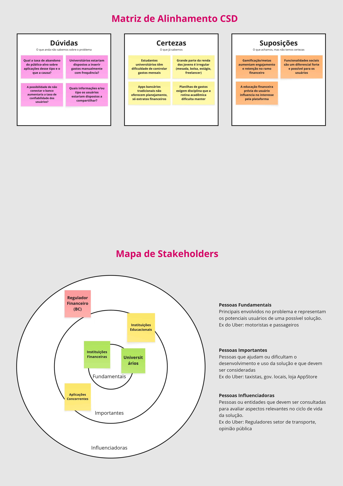
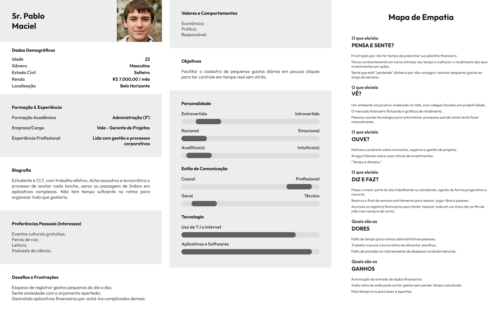
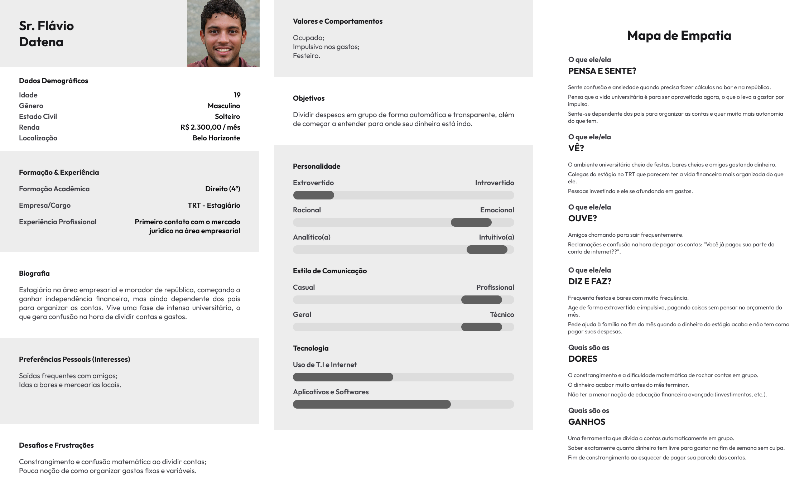
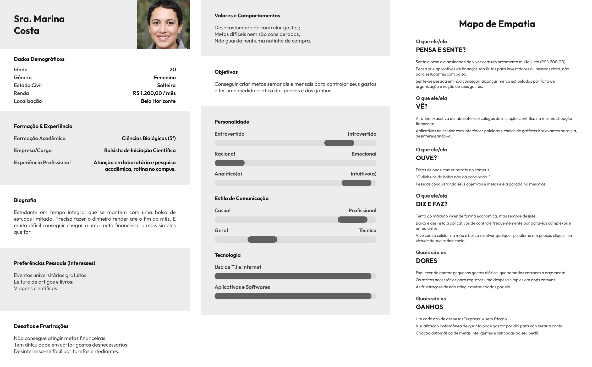
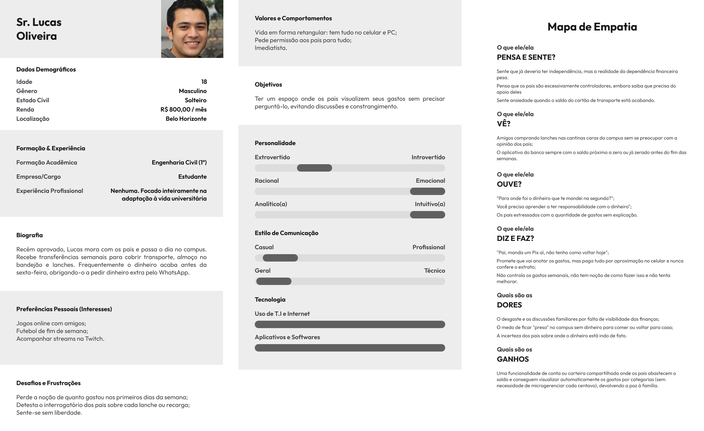
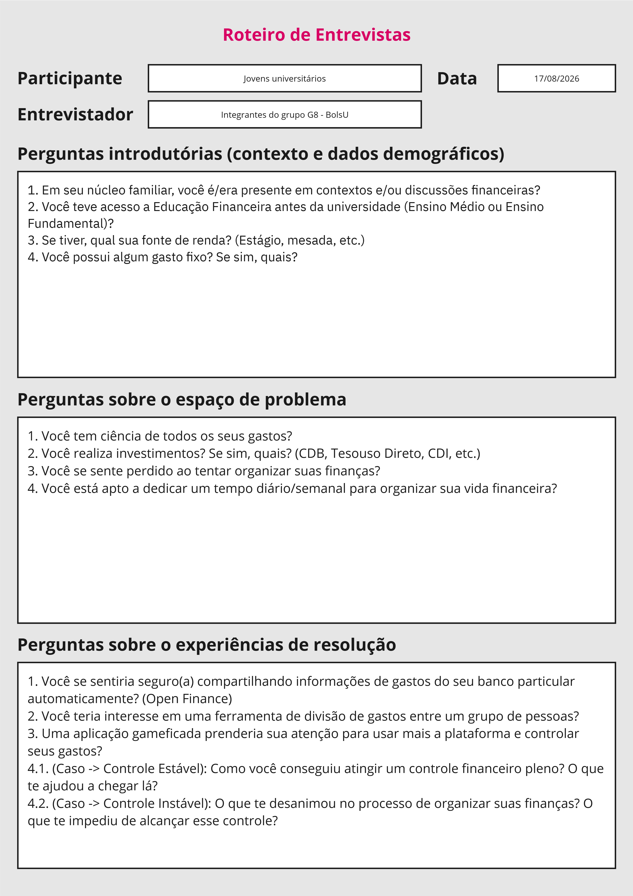

# Documentação do Projeto - Bolsu

O software foi criado como requisito para a disciplina de Trabalho Interdisciplinar: Desenvolvimento Centrado no Usuário, e partiu da premissa de priorização das experiências de interação do usuário como ponto principal do desenvolvimento. 

# Contexto 
A construção da plataforma foi dividida em duas principais fases: estratégia e implementação. Na primeira, foi utilizada a abordagem de Design Thinking, que orienta a identificação e o detalhamento de problemas potenciais a partir da perspectiva do usuário, bem como a elaboração de uma proposta de solução. Na segunda, foi utilizada a abordagem do Desenvolvimento Ágil, que divide o trabalho em sprints que resultam na entrega de software pronto e funcional. 

## Problema
Jovens universitários frequentemente apresentam dificuldades em controlar seus gastos mensais, além disso, muitos nunca tiveram educação financeira, e devido a isso não conseguem controlar e analisar os próprios gastos de modo eficiente. Grande parte dos bancos tradicionais oferecem, em sua grande maioria, funcionalidades relacionadas a extratos financeiros, mas não apresentam opções para o planejamento e visualização de gastos por categoria. Essa dificuldade se torna ainda maior diante da rotina universitária, na qual os jovens possuem diversos tipos de despesas, como alimentação, transporte, lazer, estudos e assinaturas, muitas vezes com valores e frequências diferentes.

## Objetivo
Desenvolver uma solução digital que auxilie jovens universitários no controle e planejamento de suas finanças pessoais, facilitando o registro, a organização e a visualização dos gastos e contribuindo para uma maior compreensão de seus hábitos financeiros.

Específicos
* Facilitar o registro das despesas, tornando o acompanhamento dos gastos mais simples e rápido para o usuário.
* Organizar os gastos por categorias, permitindo que o estudante identifique com maior facilidade onde sua renda está sendo utilizada.
* Auxiliar no planejamento financeiro mensal, permitindo que o usuário acompanhe sua renda, despesas e limites de gastos.
* Possibilitar o estabelecimento de metas financeiras, incentivando o usuário a definir objetivos e acompanhar seu progresso.

## Justificativa
Educação e controle financeiro podem ser tópicos novos para o cenário de jovens universitários. Muitos acabam endividados sem saber como utilizar um cartão de crédito. No entanto, esse problema vai além de apenas atrasar para pagar a fatura, ou a falta de organização dos gastos, o endividamento compromete também a saúde mental dos estudantes, e em muitos casos resultam no aumento da evasão escolar. Em pesquisa levantada pela Folha de S.Paulo os dados apresentam um cenário que requer atenção
> Segundo o recém-lançado IFEUP (Índice Fecap de Endividamento Universitário Paulista), realizado com 3.248 estudantes de instituições públicas e privadas do estado entre janeiro e março de 2026, 68,4% têm alguma dívida ativa e convivem com um cenário de vulnerabilidade financeira. Para o professor El Khatib, os primeiros anos de autonomia financeira são determinantes para o futuro do estudante. "Se essas questões não forem tratadas adequadamente desde cedo, o aluno pode carregar consequências financeiras por toda a vida." (Leite, 2026, Folha de S.Paulo).

## Público Alvo
O público-alvo do projeto é composto principalmente por jovens universitários, especialmente estudantes que estão iniciando ou consolidando sua independência financeira e que possuem dificuldades para organizar, acompanhar e planejar seus gastos mensais. O sistema é direcionado tanto para estudantes que já possuem alguma fonte de renda, como salário, estágio, bolsa ou auxílio, quanto para aqueles que dependem de recursos fornecidos pela família.

# Especificações técnicas

## Matriz CSD e MAPA DE STAKEHOLDERS

## Personas

## Roteiro de Entrevistas

